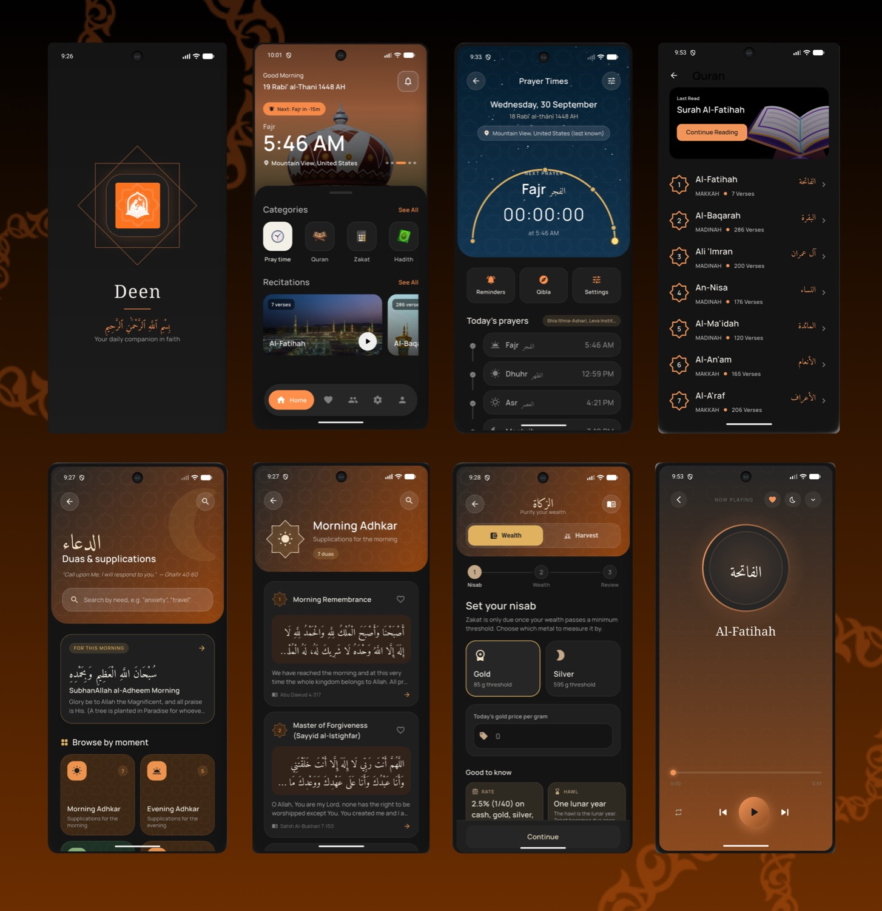

# Muhammad Ali Tahir

**Flutter Developer & Software Engineer** at DevSouq Technologies, based in Lahore, Pakistan.

I build cross-platform mobile apps with Flutter and Dart, from the first screen to a signed release on the Play Store. I care about code that stays readable as an app grows: feature-first architecture, state that is easy to test, and interfaces that feel finished.

[Portfolio](https://muhammadalitahir.vercel.app/) · [LinkedIn](https://www.linkedin.com/in/muhammad-ali-tahir-846948294) · [Email](mailto:alee155abbas@gmail.com)

---

## What I work on

- **Flutter and Dart.** Production apps with Riverpod, BLoC, Provider and GetX; custom UI, animation, light and dark themes, localization.
- **Architecture.** Feature-first Clean Architecture (domain, data, presentation), repository pattern, thin widgets and controllers that are straightforward to unit test.
- **Native Android when Dart isn't enough.** Kotlin platform channels for exact alarms, Do Not Disturb and system integrations.
- **Backend integration.** REST with Dio, Firebase (Auth, Firestore, Storage, FCM), Supabase, secure token storage, deep links and Android App Links.
- **Shipping.** Automated tests, GitHub Actions pipelines and signed Android release builds.

## Featured projects

### Deen Companion: Quran & Athan

[Google Play](https://play.google.com/store/apps/details?id=com.devsouq.deen_companion.app) · [Source](https://github.com/alee155/deen-companion)

A daily worship companion: Quran with audio recitation, prayer times with reliable reminders, Qibla, Hadith, duas, a Hijri calendar and a Zakat calculator. Live on Google Play.

- Feature-first Clean Architecture on Flutter and Riverpod, covered by 1,100+ automated tests.
- Native Kotlin for exact prayer alarms and Do Not Disturb windows, because Dart alone can't do these reliably.
- Recent work: accounts with email verification, groups with invite links (Android App Links), and a camera, crop and compression flow for sharing snaps.
- GitHub Actions pipeline: checks on every push, signed Android bundles only for release commits.

`Flutter` `Riverpod` `go_router` `Dio` `Hive` `Kotlin` `GitHub Actions`

### Vision Lab

[Source](https://github.com/alee155/vision-lab-flutter)

A Flutter playground for Google ML Kit's on-device vision models: face detection, object detection with tracking, digital ink recognition and image labeling. Everything runs locally and no frame leaves the device.

### AI Meal Planner

[Source](https://github.com/alee155/Ai_meal_planner)

AI-assisted meal planning and nutrition tracking, with localization and light and dark themes, built with GetX.

## Toolbox

  

| | |
| --- | --- |
| **Mobile** | Flutter, Dart, Kotlin (platform channels), Material 3 |
| **State management** | Riverpod, BLoC, Provider, GetX |
| **Data and backend** | REST (Dio), Firebase, Supabase, GraphQL, SQLite, Hive, MySQL |
| **Design** | Figma to Flutter, custom painters, animation, theming |
| **Workflow** | Git, GitHub Actions, unit and widget testing, Android Studio, VS Code |

## GitHub

  <picture>
    <source media="(prefers-color-scheme: dark)" srcset="https://github-readme-stats.vercel.app/api?username=alee155&show_icons=true&hide=stars,issues&include_all_commits=true&hide_border=true&bg_color=0d1117&title_color=F08232&icon_color=F08232&text_color=c9d1d9&hide_rank=true">
    
  </picture>
  <picture>
    <source media="(prefers-color-scheme: dark)" srcset="https://github-readme-stats.vercel.app/api/top-langs/?username=alee155&layout=compact&langs_count=5&hide_border=true&bg_color=0d1117&title_color=F08232&text_color=c9d1d9">
    
  </picture>

## Now

- Building: Deen Companion, adding accounts, groups and snaps.
- Learning: backend development, to connect the apps I build to the services behind them.

If you have a Flutter project, a role or a question, [email me](mailto:alee155abbas@gmail.com) or message me on [LinkedIn](https://www.linkedin.com/in/muhammad-ali-tahir-846948294).
